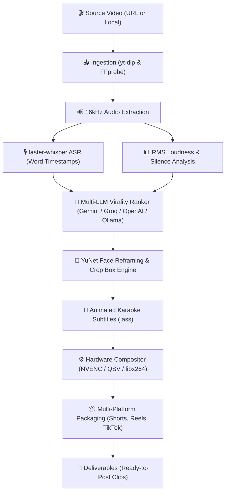

# ⚡ ClipCraft — Universal AI Video Clipper & Virality Engine

<p align="center">
  <b>Transform long-form YouTube videos, streams, and podcasts into viral 9:16 Shorts, Reels, and TikToks in seconds.</b><br>
  Local-first • Hardware-accelerated • YuNet Face Tracking • Word-Level Animated Subtitles • Multi-LLM Virality Scoring
</p>

<p align="center">
  <a href="https://github.com/mightyalok00/ClipCraft/actions/workflows/ci.yml">
    
  </a>
  <a href="https://github.com/mightyalok00/ClipCraft/actions/workflows/ci.yml">
    
  </a>
  <a href="https://github.com/mightyalok00/ClipCraft/actions/workflows/generate_clips.yml">
    
  </a>
  <a href="https://github.com/mightyalok00/ClipCraft/blob/main/LICENSE">
    
  </a>
</p>

---

## 🌟 Why ClipCraft?

ClipCraft is an open-source, local-first alternative to closed, subscription-locked clipping tools like Opus Clip and Klap. Unlike generic clippers that merely slice transcripts into arbitrary chunks, ClipCraft operates on a **multi-signal virality pipeline**:

1. **Universal Content Intelligence**: Tuned ranking algorithms specifically adapted for **Gaming & Streams**, **Podcasts & Interviews**, **Educational & Tech**, **Vlogs & Storytelling**, and **General Viral Trends**.
2. **Acoustic Peak & Dead-Air Detection**: Measures RMS audio loudness envelopes to pinpoint screams, clutch reactions, laughter, and automatically snaps cuts to natural pauses.
3. **Face-Tracking 9:16 Auto-Reframer**: OpenCV YuNet neural face detection keeps active speakers dynamically centered in the vertical frame. Also includes a **Stacked Split-Screen Layout** (webcam on top, gameplay on bottom).
4. **Animated Karaoke Subtitles**: Pixel-accurate `.ass` subtitles with word-by-word active highlights rendered via `libass` with custom typography (Montserrat, Anton, Poppins) and emoji integration.
5. **Multi-LLM Freedom**: Zero vendor lock-in. Run 100% offline with **Ollama**, or connect **Google Gemini**, **Groq (ultra-fast LLaMA 3.3 70B)**, or **OpenAI**.
6. **Multi-Platform SEO Packaging**: Generates ready-to-publish titles, descriptions, and hashtags tailored for YouTube Shorts (under 60 chars), Instagram Reels (125-char hook before the "... more" truncation), and TikTok.

---

## 🏗️ Architecture



---

## 🎯 Universal Content Archetypes

ClipCraft tunes its virality criteria prompts based on the content category:

| Category | Optimization Strategy | Ideal Layout |
| :--- | :--- | :--- |
| **🎮 Gaming / Streams** | Prioritizes streamer voice/screams/reactions over pure gameplay sound. Instant action jump cuts; ignores menus and lobby waiting. | `stacked` (Facecam + Gameplay) |
| **🎙️ Podcasts / Interviews** | Discovers "opinion bombs", counter-intuitive statements, and vulnerable moments. Ensures complete, self-contained thoughts. | `facetrack` (Active Speaker) |
| **📚 Educational / Tech** | Isolates "aha!" moments, surprising hacks, and actionable workflows. Cold opens with the promise ("Never do this..."). | `facetrack` (Centered Presenter) |
| **🤳 Vlogs / Storytelling** | Highlights emotional peaks, humorous twists, and relatable real-life moments. | `facetrack` (Dynamic Face Crop) |
| **🌐 General Virality** | Universal hook-first scoring. Guaranteed standalone comprehensibility within the first 3 seconds. | `facetrack` |

---

## 🚀 Quickstart Guide

### 1. Prerequisites

- **Python 3.10+**
- **FFmpeg 6.0+** (Compiled with `libass` and hardware encoders on your system `PATH`)

### 2. Installation

Clone the repository and install the dependencies:

```powershell
git clone https://github.com/mightyalok00/ClipCraft.git
cd ClipCraft
.\run.ps1 install
```

Or manually with pip:

```bash
pip install -r requirements.txt
```

### 3. Configure Your LLM Provider

ClipCraft supports four LLM engines. Choose your favorite in `config.local.json` or through the CLI:

```powershell
# Option A: Google Gemini (Recommended for speed & accuracy)
.\run.ps1 config --set llm_provider=gemini gemini_api_key="YOUR_GEMINI_KEY"

# Option B: Groq (Blazing fast LLaMA 3.3 70B inference)
.\run.ps1 config --set llm_provider=groq groq_api_key="YOUR_GROQ_KEY"

# Option C: Local Ollama (100% Free & Private)
.\run.ps1 config --set llm_provider=ollama ollama_model="llama3.2"

# Option D: OpenAI GPT-4o
.\run.ps1 config --set llm_provider=openai openai_api_key="YOUR_OPENAI_KEY"
```

---

## 💻 Usage

### A. Modern Browser Dashboard (Recommended)

Launch the responsive Dark Tech web interface:

```powershell
.\run.ps1 web
```

Then open [http://localhost:8000](http://localhost:8000) in your browser.

- Real-time Server-Sent Events (SSE) progress bar.
- Interactive layout toggles (Face Tracking vs Stacked Split).
- Subtitle style selector with live preview.
- In-browser video playback and one-click copy for platform captions.

### B. Command-Line Interface (CLI)

Generate clips directly from your terminal:

```powershell
# Clip a YouTube video with podcast tuning and bold yellow captions
python main.py clip "https://www.youtube.com/watch?v=EXAMPLE" -c podcast -n 3 -s bold_yellow

# Clip a local gameplay video with stacked facecam layout
python main.py clip "C:\Videos\Stream.mp4" -c gaming -l stacked -n 5

# Custom virality focus prompt
python main.py clip "https://youtu.be/..." -p "find the funniest moment when they reacted to the glitch" --open
```

### C. Available CLI Arguments

| Flag | Short | Description | Choices / Default |
| :--- | :--- | :--- | :--- |
| `source` | | YouTube/Twitch URL or local `.mp4`/`.mkv` path | Required |
| `--num-clips` | `-n` | Number of viral clips to produce | `1-10` (Default: `3`) |
| `--category` | `-c` | Content virality archetype | `general`, `gaming`, `podcast`, `education`, `vlog` |
| `--layout` | `-l` | Visual layout mode | `facetrack` (9:16), `stacked` (Split-screen), `blur_padding` (Blurred Background) |
| `--captions` | `-s` | Subtitle animation style | `bold_yellow`, `cyber_green`, `clean_minimal` |
| `--prompt` | `-p` | Custom guidance prompt to steer the LLM | Custom text string |
| `--out-dir` | `-o` | Custom output directory | Defaults to `output/shorts/` |
| `--open` | | Automatically open folder in Windows Explorer | Flag |

### D. Trigger Workflows on GitHub (One-Click "Run Workflow")

You can run automated test suites or trigger cloud clipping jobs directly from the GitHub UI:

1. **Run CI & Test Suite Button:**
   - Go to [**GitHub Actions → CI & Test Suite**](https://github.com/mightyalok00/ClipCraft/actions/workflows/ci.yml).
   - Click the **"Run workflow"** button on the right.
   - Choose your verification task (`all`, `unit_tests`, or `lint_check`) and click **Run workflow**.

2. **Run Cloud Clipping Job Button:**
   - Go to [**GitHub Actions → Generate Shorts & Clips**](https://github.com/mightyalok00/ClipCraft/actions/workflows/generate_clips.yml).
   - Click the **"Run workflow"** button on the right.
   - Paste your YouTube URL, select your content category and caption style, and click **Run workflow**.
   - Download the rendered clips directly from the **Artifacts** section once complete.

---

## 🎨 Subtitle Style Presets

ClipCraft bundles studio typography embedded directly into the repository:

1. **Bold Yellow (`bold_yellow`)**:
   - Font: `Montserrat Black`
   - Active Color: Bright Warm Gold (`#FFE14D`) with thick black borders.
   - Ideal for: MrBeast-style energetic retention and educational clips.
2. **Cyber Neon (`cyber_green`)**:
   - Font: `Anton Regular`
   - Active Color: Electric Cyber Green (`#00FF66`).
   - Ideal for: Gaming streams, esports highlights, and high-octane action.
3. **Clean Minimal (`clean_minimal`)**:
   - Font: `Poppins Black`
   - Active Color: Clean Cyan (`#00FFFF`).
   - Ideal for: Thought leadership, business podcasts, and clean aesthetics.

---

## ⚙️ Hardware Acceleration

ClipCraft automatically inspects your hardware on boot:

- **NVIDIA GPU**: Automatically invokes `-c:v h264_nvenc -preset p4 -cq 23` for lightning-fast GPU encodes.
- **Intel CPU / Arc**: Leverages `-c:v h264_qsv` if available.
- **CPU Fallback**: Gracefully falls back to high-quality multi-threaded `libx264`.
- **Whisper Acceleration**: Uses `ctranslate2` CUDA execution with FP16 when an NVIDIA card is present.

---

## 🧪 Automated Testing

ClipCraft includes an extensive test suite covering unit math, API security, input validation, and edge cases (37 tests, 100% passing):

```powershell
.\run.ps1 test
```

Or run pytest directly:

```powershell
pytest tests/ -v
```

---

## 📁 Repository Structure

```text
E:\ClipCraft\
├── assets\
│   ├── emoji\              # High-res Twemoji PNGs for burned-in reaction icons
│   ├── fonts\              # Bundled OFL/Apache typography (Montserrat, Anton, etc.)
│   └── models\             # YuNet ONNX face detection neural model
├── core\
│   ├── ingestion.py        # yt-dlp download & FFprobe stream analyzer
│   ├── transcriber.py      # faster-whisper word-level ASR with disk cache
│   ├── signals.py          # RMS loudness curves, excitement peaks & silence snip
│   ├── ranker.py           # Multi-provider LLM virality scoring & prompt matrix
│   ├── vision.py           # YuNet face tracking & 9:16 reframing box math
│   ├── subtitles.py        # Animated karaoke .ass generator with active highlight
│   ├── compositor.py       # Hardware-accelerated FFmpeg multi-filter compositor
│   ├── packaging.py        # Multi-platform SEO metadata (Shorts, Reels, TikTok)
│   └── pipeline.py         # End-to-end master coordinator & progress events
├── web\
│   ├── server.py           # FastAPI REST & SSE streaming server with security headers
│   └── static\
│       └── index.html      # Responsive Dark Tech single-page dashboard
├── tests\
│   ├── test_clipcraft.py   # Signal, subtitle, ranker, and vision tests
│   ├── test_api.py         # REST endpoints, SSE, and cancellation tests
│   ├── test_security.py    # SSRF, path traversal, and secret masking
│   └── test_edge_cases.py  # Aspect ratio, unicode, and empty audio edge cases
├── config.py               # Hardware detection & settings manager
├── main.py                 # Unified CLI entry point
├── run.ps1                 # Windows PowerShell task runner
└── requirements.txt        # Python dependency manifest
```

---

## 📄 License

ClipCraft is released under the **MIT License**. Open-source assets included:

- OpenCV YuNet face detector: MIT License.
- Fonts (Montserrat, Anton, Poppins): SIL Open Font License (OFL).
- Emoji icons: Twitter Twemoji (CC-BY 4.0).
